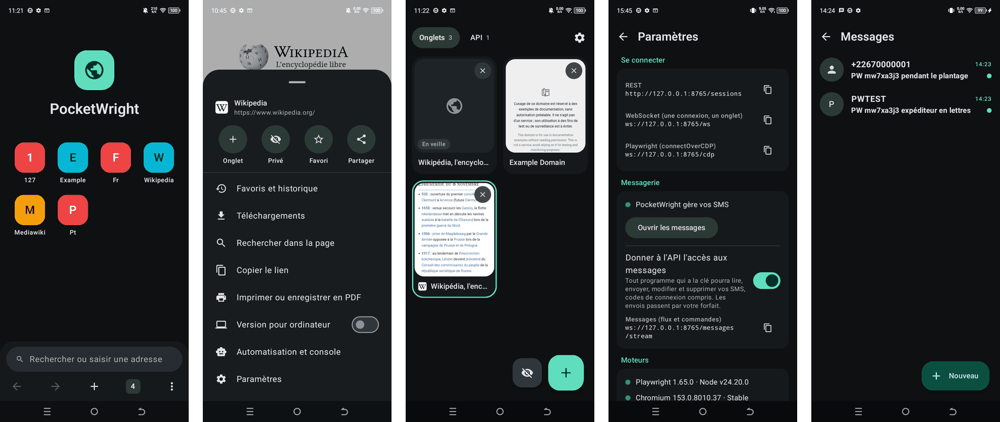

<div align="center">


# PocketWright

**Un navigateur Android complet, dont chaque onglet est aussi une session Playwright,<br>
pilotée par une API locale sur le téléphone lui-même.**

[](https://github.com/afroni-sas/PocketWright/actions/workflows/ci.yml)
[](https://github.com/afroni-sas/PocketWright/releases/latest)
[](LICENSE)


[](CONTRIBUTING.md)

[Démarrage rapide](#démarrage-rapide) · [Documentation](#documentation) · [Contribuer](CONTRIBUTING.md) · [Read in English](README.md)



</div>

## Pourquoi PocketWright ?

Playwright ne sait pas lancer de navigateur sur Android : sa prise en charge d'Android exige un ordinateur branché en ADB.
PocketWright supprime l'ordinateur. Le vrai `playwright-core` tourne **dans l'app**, sur un Node.js embarqué, et pilote
le Chromium du téléphone. Tout ce qui peut joindre `127.0.0.1` sur le téléphone (un script Termux, une autre app, ou un
PC par `adb forward`) peut ouvrir une session et la commander.

C'est aussi un navigateur pour tous les jours. Les onglets ouverts à la main et les sessions ouvertes par l'API
cohabitent, et vous pouvez regarder une session automatisée travailler en direct.

Ni root ni Google Play ne sont nécessaires.

## Fonctionnalités

| | |
| --- | --- |
| **Un vrai navigateur** | Barre d'adresse et de recherche, onglets avec aperçus, navigation privée, favoris, historique, téléchargements, impression en PDF, recherche dans la page, version pour ordinateur, popups, envoi de fichiers, vidéo plein écran, permissions par site, ouverture des liens des autres apps. |
| **Playwright complet** | Le vrai `playwright-core`, avec ses sélecteurs et son attente automatique. À piloter en REST, en WebSocket, ou directement par `chromium.connectOverCDP`. Scripts Playwright libres pris en charge. |
| **Sessions persistantes** | Chaque connexion à l'API a son propre profil isolé. Une session survit aux déconnexions et aux redémarrages de l'app ; seule une commande de fermeture la termine. |
| **Une empreinte par session** | Chaque session se présente comme un vrai téléphone différent et cohérent, dans les pages, les iframes, les workers et les en-têtes HTTP. Elle reste stable d'une visite à l'autre et peut changer à la volée. |
| **Toujours actif** | Un service de premier plan porte le serveur et les onglets, redémarre avec le téléphone et se relance tout seul si le moteur se fige. |
| **Mises à jour sans Google Play** | Mettez à jour Chromium et Playwright depuis l'app, avec contrôle d'intégrité et retour en arrière automatique. |
| **Messagerie en option** | PocketWright peut devenir l'app SMS du téléphone et diffuser les messages entrants par l'API, avec tout le CRUD sur un seul socket. Désactivé par défaut. |

## Démarrage rapide

**1. Installer l'app.** Téléchargez l'APK de la [dernière version](https://github.com/afroni-sas/PocketWright/releases/latest),
puis installez-le sur un téléphone arm64 sous Android 8.0 ou plus récent, directement sur le téléphone ou depuis un ordinateur :

```bash
adb install PocketWright-0.1.0-arm64-v8a.apk
```

N'ajoutez pas `-g` à `adb install` : cette option accorderait d'un coup toutes les permissions, SMS et contacts compris.
Vous pouvez [vérifier le téléchargement](SECURITY.md#verifying-a-release) ou
[construire depuis les sources](#construire-depuis-les-sources).

**2. Récupérer la clé de l'API.** Ouvrez l'app, puis **Paramètres → API locale**.

**3. Joindre l'API.** Sur le téléphone, elle est à `http://127.0.0.1:8765`. Depuis un ordinateur :

```bash
adb forward tcp:8765 tcp:8765
```

**4. Ouvrir une session et la commander.**

```bash
curl -X POST http://127.0.0.1:8765/sessions -H "Authorization: Bearer $KEY" -d '{"name":"demo","url":"https://example.com"}'
```

```bash
curl -X POST http://127.0.0.1:8765/sessions/$ID/click -H "Authorization: Bearer $KEY" -d '{"selector":"a"}'
```

Ou utilisez votre code Playwright habituel :

```js
import { chromium } from 'playwright-core';

const browser = await chromium.connectOverCDP(
  `ws://127.0.0.1:8765/cdp?key=${process.env.KEY}`,
  { isWebView: true },
);
const page = browser.contexts()[0].pages()[0];
await page.goto('https://example.com');
console.log(await page.title());
await browser.close(); // Déconnecte. La session reste ouverte sur le téléphone.
```

### Construire depuis les sources

Il faut un JDK 17, le SDK Android (compile SDK 37), le NDK `30.0.16248370`, CMake `4.1.2`, et Node.js avec npm. Détails dans
le [guide de développement](docs/development.md) (en anglais).

```bash
git clone https://github.com/afroni-sas/PocketWright.git
```

```bash
cd PocketWright && ./gradlew :app:assembleRelease -Ppocketwright.abis=arm64-v8a
```

```bash
adb install -r app/build/outputs/apk/release/app-release.apk
```

Prenez le build release : sur un petit téléphone, le build debug démarre environ dix fois moins vite. Un build depuis les
sources est signé avec une clé de développement : il ne peut pas mettre à jour un APK publié, ni l'inverse. Pour passer de
l'un à l'autre, il faut désinstaller, ce qui efface les données de l'app.

## L'API en bref

| Interface | Adresse | Pour quoi faire |
| --- | --- | --- |
| REST | `/sessions`, `/sessions/{id}/{action}` | Des commandes ponctuelles, environ 70 actions |
| WebSocket | `/ws` | Une connexion, une session, et les événements en direct |
| CDP | `/cdp`, `/cdp/{id}` | Les clients Playwright et Puppeteer |
| Empreintes | `/sessions/{id}/fingerprint`, `/fingerprints/devices` | Lire, changer, lister les appareils |
| Mises à jour | `/updates` | Mettre à jour Chromium et Playwright |
| Messages | `/messages/stream` | Flux et CRUD des SMS/MMS, après accord explicite |

La référence complète est dans [docs/api.md](docs/api.md) (en anglais).

## Comment ça marche

Playwright se connecte aux WebViews de l'app en CDP, à travers une passerelle qui ne lui montre que les pages de sa
session. La passerelle implémente aussi ce qu'une WebView ne fait pas au niveau navigateur : `newPage`, `newContext`,
cookies, captures hors écran. Voir [docs/architecture.md](docs/architecture.md).

## État du projet

PocketWright est jeune et développé sur **un seul téléphone physique**. Considérez les autres appareils comme non testés,
et [dites-nous comment il se comporte sur le vôtre](https://github.com/afroni-sas/PocketWright/issues/new/choose).

Dernière exécution complète, sur un TECNO BG7n (MT6765, 3,9 Go de RAM, Android 13), avec Chromium 156.0.8078.47 et
Playwright 1.65.0 :

| Suite | Résultat |
| --- | --- |
| Navigateur et API, de bout en bout | 166 contrôles sur 166 |
| Empreintes | 180 contrôles sur 180 |
| Messagerie | 78 sur 78 sur un moteur précédent ; pas encore rejouée sur Chromium 156 |

Performance sur ce même téléphone, avant et après le travail d'optimisation :

| | Avant | Après |
| --- | --- | --- |
| Démarrage à froid | 8,2 s | 0,66 s |
| Images saccadées | 38 % | 7 % |
| 99e centile d'une image | 2 150 ms | 150 ms |
| Mémoire après un parcours complet | 4 Go | 790 Mo |

Les bugs connus et les zones non testées sont listés dans [BUGS.md](BUGS.md).

### Limites

Une WebView n'est pas Chrome. Ce qui n'existe pas dans ce moteur :

- Les extensions, Web Push, l'installation d'applications web (PWA), la synchronisation de compte et la traduction intégrée.
- `page.pdf()` et les événements `download` de Playwright. L'impression PDF du menu fonctionne, et l'API émet son propre événement `download`.
- Une adresse IP par session : le proxy de WebView vaut pour toute l'app, donc **toutes les sessions partagent la même IP**.
- L'envoi de MMS, et RCS, fermé aux applications tierces.

L'interface de l'app et les messages d'erreur de l'API sont pour l'instant en français.
[Les traductions font partie des contributions les plus utiles](CONTRIBUTING.md#good-first-contributions).

## Sécurité

L'API n'écoute que sur `127.0.0.1` et exige une clé par défaut, car toute app du téléphone peut joindre le localhost.
Elle refuse aussi les appels venant de pages web.

**La clé donne tout pouvoir** sur les onglets et les comptes connectés, et l'action `run` exécute du code dans l'app.
Ne la donnez qu'à des programmes de confiance.

Si PocketWright devient votre app SMS, il détient vos SMS et vos contacts. Avec le moteur Chromium de l'app, les processus
de rendu ne sont pas isolés comme ceux d'un Chrome installé : une faille du navigateur pourrait atteindre ces données.
Pesez ce risque sur un téléphone qui reçoit vos codes bancaires ou de connexion.

Voir [SECURITY.md](SECURITY.md) pour le modèle de menace et le signalement privé d'une faille.

## Usage responsable

PocketWright est conçu pour le test, la recherche, l'accessibilité et l'automatisation de vos propres comptes et services.
L'isolation d'empreinte sépare les sessions entre elles ; elle ne rend pas invisible. N'utilisez pas ce projet pour
enfreindre les règles d'un service, commettre une fraude, envoyer des messages non sollicités, ou accéder à des données
ou comptes sans autorisation. Vous êtes responsable de l'usage que vous en faites.

## Documentation

Les guides détaillés sont en anglais.

| Guide | Contenu |
| --- | --- |
| [Référence de l'API](docs/api.md) | REST, WebSocket, CDP, chaque action et erreur |
| [Architecture](docs/architecture.md) | Composants, circuit d'une commande, cycle de vie des sessions |
| [Empreintes](docs/fingerprints.md) | Construction des identités, et ce qu'on ne peut pas masquer |
| [Messagerie](docs/messaging.md) | Rôle de messagerie, flux, CRUD, reprise sans perte |
| [Mises à jour](docs/updates.md) | Mettre à jour Chromium et Playwright sans Google Play |
| [Développement](docs/development.md) | Outils, options de build, débogage, montées de version |
| [Tests de bout en bout](tests/e2e/README.md) | Lancer les suites sur un vrai téléphone |
| [Bugs connus](BUGS.md) | Corrigés, ouverts, zones non testées |

## Contribuer

Toutes les contributions sont les bienvenues : retours sur votre téléphone, corrections, traductions, documentation,
fonctionnalités. Commencez par [CONTRIBUTING.md](CONTRIBUTING.md), qui liste de bonnes premières contributions. Les issues
et les pull requests peuvent être écrites en français ou en anglais. Questions et idées vont dans les
[Discussions](https://github.com/afroni-sas/PocketWright/discussions). Chacun suit notre
[code de conduite](CODE_OF_CONDUCT.md).

## Licence

Sous [licence Apache 2.0](LICENSE). Les mentions des composants tiers sont dans [NOTICE](NOTICE).

PocketWright est un projet indépendant, créé par [AFRONI](https://www.afroni.com). Il n'est ni affilié à Microsoft, Google,
au projet Chromium ou à LineageOS, ni approuvé par eux.
