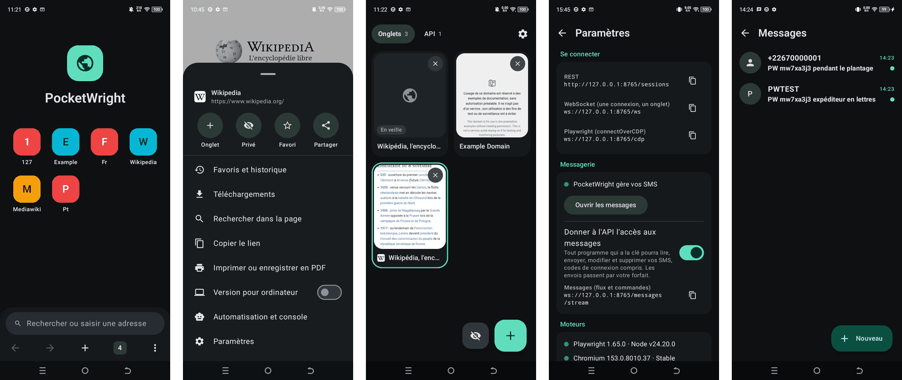
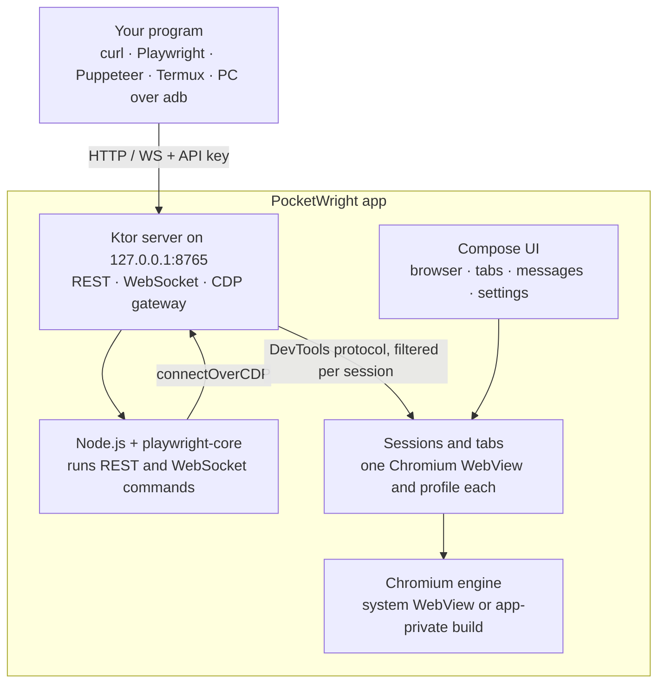

<div align="center">


# PocketWright

**A full Android browser in which every tab is also a Playwright session,<br>
controlled through a local API on the phone itself.**

[](https://github.com/afroni-sas/PocketWright/actions/workflows/ci.yml)
[](https://github.com/afroni-sas/PocketWright/releases/latest)
[](LICENSE)


[](CONTRIBUTING.md)

[Quick start](#quick-start) · [Documentation](#documentation) · [Contributing](CONTRIBUTING.md) · [Lire en français](README.fr.md)



</div>

## Why PocketWright?

Playwright cannot launch a browser on Android: its Android support needs a computer attached over ADB.
PocketWright removes the computer. The real `playwright-core` runs **inside the app**, on an embedded Node.js, and
drives the phone's own Chromium. Anything that can reach `127.0.0.1` on the phone (a Termux script, another app, or
a PC through `adb forward`) can open a session and control it.

It is also a browser you can use every day. Tabs you open by hand and sessions opened by the API live side by side,
and you can watch an automated session work in real time.

No root and no Google Play are needed.

## Features

| | |
| --- | --- |
| **A real browser** | Address and search bar, tabs with previews, private browsing, bookmarks, history, downloads, print to PDF, find in page, desktop mode, pop-ups, file uploads, full-screen video, per-site permissions, handling of links from other apps. |
| **Full Playwright** | Real `playwright-core` with its selectors and auto-waiting. Drive it through REST, WebSocket, or directly with `chromium.connectOverCDP`. Free-form Playwright scripts are supported. |
| **Persistent sessions** | Each API connection gets its own isolated profile. A session survives disconnections and app restarts, and only an explicit close command ends it. |
| **One fingerprint per session** | Each session presents itself as a different, coherent, real phone, across pages, iframes, workers and HTTP headers. It stays stable between visits and can be changed on the fly. |
| **Always on** | A foreground service hosts the server and the tabs, restarts with the phone, and recovers on its own if the engine hangs. |
| **Updates without Google Play** | Update Chromium and Playwright from inside the app, with integrity checks and automatic rollback. |
| **Optional messaging** | PocketWright can become the phone's SMS app and stream incoming messages over the API, with full CRUD on one socket. Off by default. |

## Quick start

**1. Install the app.** Download the APK from the [latest release](https://github.com/afroni-sas/PocketWright/releases/latest),
then install it on an arm64 phone running Android 8.0 or later, either directly on the phone or from a computer:

```bash
adb install PocketWright-0.1.0-arm64-v8a.apk
```

Do not add `-g` to `adb install`: it would grant every permission at once, including SMS and contacts. You can
[verify the download](SECURITY.md#verifying-a-release) or [build from source](#build-from-source).

**2. Get the API key.** Open the app and go to **Paramètres → API locale** (Settings → Local API).

**3. Reach the API.** On the phone, it is at `http://127.0.0.1:8765`. From a computer:

```bash
adb forward tcp:8765 tcp:8765
```

**4. Open a session and control it.**

```bash
curl -X POST http://127.0.0.1:8765/sessions -H "Authorization: Bearer $KEY" -d '{"name":"demo","url":"https://example.com"}'
```

```bash
curl -X POST http://127.0.0.1:8765/sessions/$ID/click -H "Authorization: Bearer $KEY" -d '{"selector":"a"}'
```

Or use your usual Playwright code:

```js
import { chromium } from 'playwright-core';

const browser = await chromium.connectOverCDP(
  `ws://127.0.0.1:8765/cdp?key=${process.env.KEY}`,
  { isWebView: true },
);
const page = browser.contexts()[0].pages()[0];
await page.goto('https://example.com');
console.log(await page.title());
await browser.close(); // Disconnects. The session stays open on the phone.
```

### Build from source

You need JDK 17, the Android SDK (compile SDK 37), NDK `30.0.16248370`, CMake `4.1.2`, and Node.js with npm. See the
[development guide](docs/development.md) for details.

```bash
git clone https://github.com/afroni-sas/PocketWright.git
```

```bash
cd PocketWright && ./gradlew :app:assembleRelease -Ppocketwright.abis=arm64-v8a
```

```bash
adb install -r app/build/outputs/apk/release/app-release.apk
```

Use the release build: on a low-end phone, the debug build starts about ten times slower. A build from source is signed
with a development key, so it cannot update a published APK, or the reverse. Switching requires uninstalling first, which
erases the app's data.

## API at a glance

| Interface | Address | Use it for |
| --- | --- | --- |
| REST | `/sessions`, `/sessions/{id}/{action}` | One-off commands, about 70 actions |
| WebSocket | `/ws` | One connection, one session, plus live events |
| CDP | `/cdp`, `/cdp/{id}` | Playwright and Puppeteer clients |
| Fingerprints | `/sessions/{id}/fingerprint`, `/fingerprints/devices` | Read, change, list devices |
| Updates | `/updates` | Update Chromium and Playwright |
| Messages | `/messages/stream` | SMS/MMS stream and CRUD, after explicit opt-in |

The complete reference is in [docs/api.md](docs/api.md).

## How it works



Playwright connects to the app's WebViews over CDP, through a gateway that shows it only the pages of its own session.
The gateway also implements what a WebView lacks at browser level, such as `newPage`, `newContext`, cookies and
off-screen screenshots. Read more in [docs/architecture.md](docs/architecture.md).

## Status

PocketWright is young and developed against **one physical phone**. Treat other devices as untested, and please
[report how it behaves on yours](https://github.com/afroni-sas/PocketWright/issues/new/choose).

Last full run, on a TECNO BG7n (MT6765, 3.9 GB RAM, Android 13) with Chromium 156.0.8078.47 and Playwright 1.65.0:

| Suite | Result |
| --- | --- |
| Browser and API, end to end ([`scenario.mjs`](tests/e2e/scenario.mjs)) | 166 of 166 checks |
| Fingerprints ([`fingerprint/run.mjs`](tests/e2e/fingerprint/run.mjs)) | 180 of 180 checks |
| Messaging ([`messages.mjs`](tests/e2e/messages.mjs)) | 78 of 78, on an earlier engine; not yet replayed on Chromium 156 |

Performance on the same phone, before and after the optimization work:

| | Before | After |
| --- | --- | --- |
| Cold start | 8.2 s | 0.66 s |
| Janky frames | 38 % | 7 % |
| 99th-percentile frame time | 2,150 ms | 150 ms |
| Memory after a full browsing run | 4 GB | 790 MB |

Known bugs and untested areas are listed in [BUGS.md](BUGS.md).

### Limitations

A WebView is not Chrome. These features do not exist in this engine:

- Browser extensions, Web Push, installing web apps (PWA), account sync and built-in translation.
- Playwright's `page.pdf()` and `download` events. The menu's Print to PDF works, and the API emits its own `download` event.
- Per-session IP addresses: the WebView proxy applies to the whole app, so **every session shares one IP**.
- Sending MMS, and RCS, which is closed to third-party apps.

The app's interface and the API's error messages are currently in French.
[Translations are one of the most useful contributions](CONTRIBUTING.md#good-first-contributions).

## Security

The API listens on `127.0.0.1` only and requires a key by default, since any app on the phone can reach localhost.
It also rejects calls coming from web pages.

**The key gives full control** over tabs and logged-in accounts, and the `run` action executes code inside the app.
Only give it to programs you trust.

If you make PocketWright your SMS app, it holds your SMS and contacts. With the app-private Chromium engine, renderer
processes are not sandboxed the way an installed Chrome's are, so a browser exploit could reach that data. Weigh this
carefully on a phone that receives bank or login codes.

See [SECURITY.md](SECURITY.md) for the threat model and how to report a vulnerability privately.

## Responsible use

PocketWright is built for testing, research, accessibility and automating your own accounts and services. Fingerprint
isolation separates sessions from each other; it does not make you invisible. Do not use this project to break a
service's terms, commit fraud, send unsolicited messages, or access data or accounts you are not authorized to use. You
are responsible for how you use it.

## Documentation

| Guide | Contents |
| --- | --- |
| [API reference](docs/api.md) | REST, WebSocket, CDP, every action and error |
| [Architecture](docs/architecture.md) | Components, command flow, session lifecycle |
| [Fingerprints](docs/fingerprints.md) | How identities are built, and what cannot be hidden |
| [Messaging](docs/messaging.md) | Default SMS role, stream, CRUD, resuming without loss |
| [Updates](docs/updates.md) | Updating Chromium and Playwright without Google Play |
| [Development](docs/development.md) | Toolchain, build flags, debugging, dependency bumps |
| [End-to-end tests](tests/e2e/README.md) | Running the real-device suites |
| [Known bugs](BUGS.md) | Fixed issues, open issues, untested areas |

## Project layout

```text
app/          Android app: Kotlin, Compose, JNI launcher for Node.js
engine/       Node.js project embedded in the APK, around playwright-core
webviewup/    Modified copy of WebViewUpgrade, loads an app-private Chromium
scripts/      Build-time preparation of Node.js and the engine
tests/e2e/    End-to-end suites that run against a real phone
docs/         Guides and images
```

## Contributing

Contributions of every size are welcome: device reports, bug fixes, translations, documentation and features. Start
with [CONTRIBUTING.md](CONTRIBUTING.md), which lists good first contributions. Questions and ideas go in
[Discussions](https://github.com/afroni-sas/PocketWright/discussions). All participants follow our
[Code of Conduct](CODE_OF_CONDUCT.md).

## License

Licensed under the [Apache License 2.0](LICENSE). Third-party notices are in [NOTICE](NOTICE).

## Acknowledgments

PocketWright stands on [Playwright](https://github.com/microsoft/playwright),
[Node.js for mobile](https://github.com/digidem/nodejs-mobile), [Chromium](https://www.chromium.org/),
[LineageOS](https://lineageos.org/)'s WebView builds, [WebViewUpgrade](https://github.com/JonaNorman/WebViewUpgrade)
and [Ktor](https://ktor.io/).

PocketWright is an independent project, created by [AFRONI](https://www.afroni.com). It is not affiliated with or
endorsed by Microsoft, Google, the Chromium project or LineageOS.
