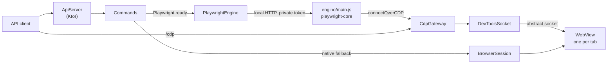
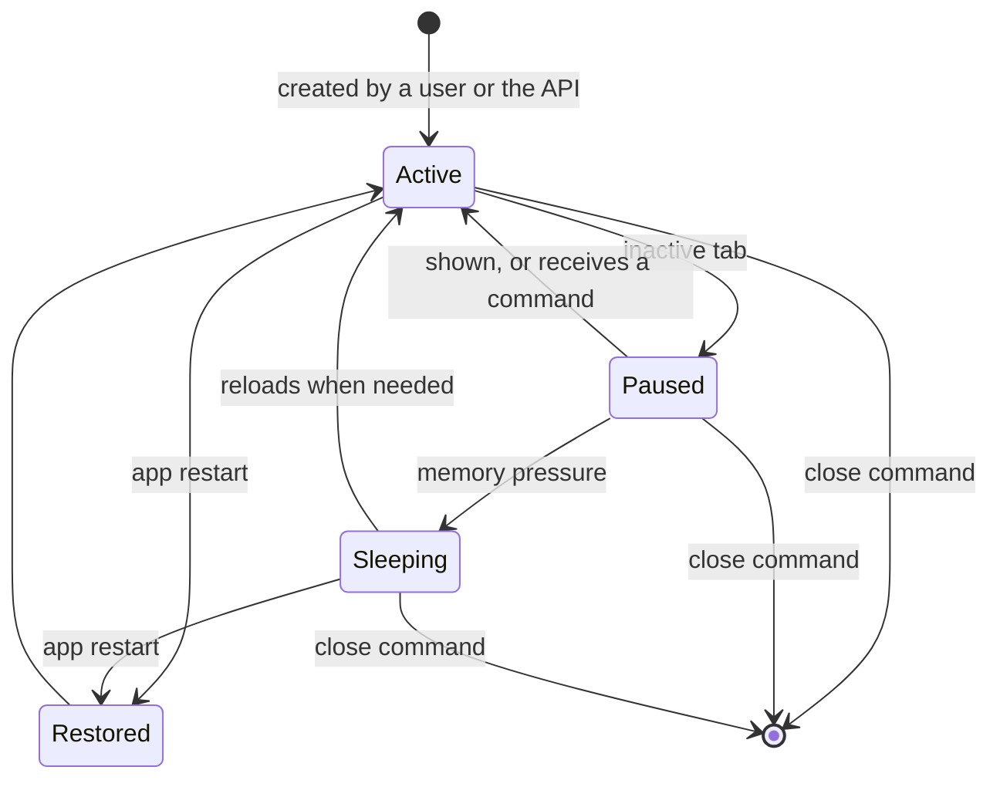

# Architecture

PocketWright is one Android app with three runtimes in it: Kotlin for the app and the server, Node.js for Playwright, and
Chromium for the pages.

## Components

Kotlin paths are relative to `app/src/main/java/com/afroni/pocketwright/`.

| Component | Location | Role |
| --- | --- | --- |
| Application | `PocketWrightApp.kt` | Holds what the service, the server and the screens share: one process, one tab list |
| Foreground service | `service/PocketWrightService.kt` | Hosts the server, the engine and the tabs, even with the screen off, and watches itself |
| Boot receiver | `service/BootReceiver.kt` | Restarts the service with the phone and after an app update |
| Server | `api/ApiServer.kt` | REST, WebSocket and CDP routes, authentication |
| Commands | `api/Commands.kt` | Sends an action to Playwright, or to the native fallback |
| Sessions | `session/SessionManager.kt`, `session/BrowserSession.kt` | Tab lifecycle, profiles, persistence, memory limits |
| CDP gateway | `cdp/CdpGateway.kt` | Filters DevTools per session and implements what WebView lacks |
| DevTools access | `cdp/DevToolsSocket.kt`, `cdp/TargetLocator.kt` | Connects to the WebViews' DevTools and maps targets to sessions |
| Engine host | `engine/PlaywrightEngine.kt`, `app/src/main/cpp/` | Starts Node.js through JNI, and forwards commands to it |
| Engine | `engine/main.js` | Runs each session through the real Playwright |
| Fingerprints | `fingerprint/` | Device catalog, native overrides, and the page script |
| Updates | `update/` | Downloading, verifying and installing Chromium and Playwright |
| Messaging | `messaging/`, `api/MessageCommands.kt` | Default SMS role, SMS/MMS storage, journal for the stream |
| Interface | `ui/` | Compose screens |
| Chromium loader | `webviewup/` | Loads an app-private Chromium without installing it system-wide |

## Why a CDP gateway?

Playwright cannot launch a browser on Android, so it attaches to running WebViews with `connectOverCDP`. Used directly, this
would not work well:

- Android exposes **all** of an app's WebViews through one DevTools socket. Sessions must not see each other.
- A WebView has no browser-level target management, so `newPage`, `newContext` and `Storage.*` cookie calls fail.
- Screenshots of a hidden WebView fail unless they are handled by the app.

`CdpGateway` sits between the client and DevTools. It shows a client only the pages of its session and their pop-ups, and
translates browser-level calls into page-level ones or into app actions. The socket
`webview_devtools_remote_<pid>` is reachable from the app itself because Chromium accepts connections from the same UID.

`TargetLocator` finds which DevTools target belongs to which WebView by placing a temporary marker in the page title. This
avoids talking to frozen tabs, which would hang.

## Session lifecycle

- An API session stays active for five minutes after its last command, and as long as a client is connected.
- A command automatically wakes a paused or sleeping session.
- After a restart, sessions keep their identifiers, cookies and storage, but only the most recent ones reopen immediately.
- The number of tabs kept in memory follows the phone's RAM.

## Staying alive

Low-end Android phones are aggressive about killing background work, so several mechanisms overlap:

- A foreground service with `START_STICKY`.
- A restart at boot and after app updates.
- An exact alarm that checks the service every five minutes, needed on phones that do not restart services on their own.
- A watchdog that restarts the app if the engine hangs.

## Chromium processes

Chromium keeps one renderer process per site visited by default, which exhausts memory on a low-end phone. A reaper terminates
cached renderers beyond a quota. When a renderer belonging to a hidden tab is terminated, the tab goes to sleep.

The modified WebViewUpgrade in `webviewup/` gives each renderer instance requested by Chromium its own service slot (20 of
them), and frees it when Chromium releases the renderer.

## Performance notes

What made the largest difference on the reference phone:

- R8 and a release build: without them, Compose runs interpreted.
- Loading the engine after the first frame.
- Node's compile cache.
- Pausing inactive tabs, reopening only recent ones, and reaping extra renderers.
- Compressed native libraries in the APK (`libnode.so` goes from about 85 MB to 30 MB).
